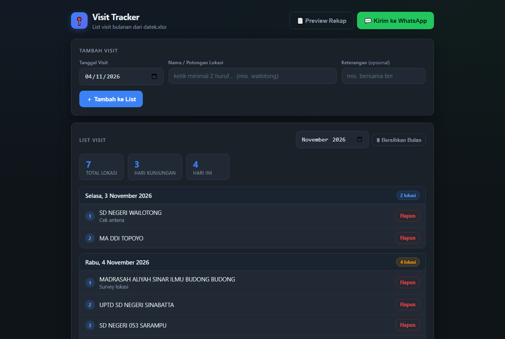
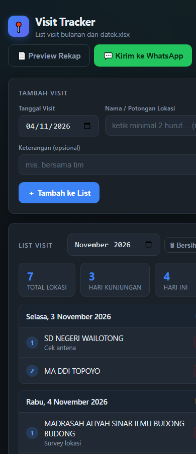

# 📍 Visit Tracker

> Otomasi **list visit bulanan** dari Excel → form browser → rekap terkirim ke WhatsApp.
>
> Ketik potongan nama lokasi, pilih dari daftar site, tersimpan rapi per hari — sekali klik rekap sebulan sampai ke WhatsApp.


---

## 📸 Demo



<details>
<summary>📱 Tampilan Mobile</summary>



</details>

---

## ✨ Fitur

| | Fitur | Deskripsi |
|---|-------|-----------|
| 🔍 | **Smart Search** | Ketik 2+ huruf → saran site fuzzy match (awal kata > di tengah > substring) |
| 📅 | **Group per Hari** | List otomatis dikelompokkan per tanggal, badge jumlah lokasi |
| 📊 | **Statistik** | Total lokasi, hari kunjungan, kunjungan hari ini |
| 📄 | **Excel Storage** | Tersimpan di `visits/visit-YYYY-MM.xlsx` — mudah dibuka & diedit |
| 📝 | **Preview Rekap** | Lihat teks rekap sebelum dikirim |
| 💬 | **WhatsApp Kirim** | Rekap sebulan terkirim via QR scan (sekali saja) |
| 🛡️ | **Validasi** | Site harus ada di Excel, duplikat per hari ditolak |

## 🚀 Quick Start

```bash
git clone https://github.com/Pidzzzz/wa-excel-tracker.git
cd wa-excel-tracker
npm install
```

**1. Edit `config.json`**

```json
{
  "excelFile": "path/ke/datek.xlsx",
  "targetNumber": "628xxxxxxxxxx",
  "siteColumn": "NAMA LOKASI"
}
```

**2. Jalankan**

```bash
npm start
```

**3. Buka** → [http://localhost:3100](http://localhost:3100)

## 📖 Alur Pakai

```
┌─────────────────────────────────────────────────────────┐
│  BROWSER                                                │
│                                                         │
│  Tanggal: [04/11/2026]                                  │
│  Lokasi:  [wailotong____] ──┐                           │
│                             ▼                           │
│                    ┌──────────────────┐                 │
│                    │ SD NEGERI WAI... │  ← fuzzy match  │
│                    │ MA DDI TOPOYO    │    dari Excel    │
│                    └──────────────────┘                 │
│                             │ pilih                     │
│                             ▼                           │
│                    [＋ Tambah ke List]                   │
│                                                         │
│  📅 Rabu, 4 November 2026          2 lokasi badge       │
│   1. SD NEGERI WAILOTONG          [Hapus]               │
│   2. MA DDI TOPOYO                [Hapus]               │
│                                                         │
│  [📄 Preview Rekap]  [💬 Kirim ke WhatsApp]             │
└──────────────────────────┬──────────────────────────────┘
                           │
              ┌────────────┴────────────┐
              ▼                         ▼
   visits/visit-2026-11.xlsx    WhatsApp (QR scan 1x)
   (Excel bulanan)              rekap → nomor Anda
```

## ⚙️ Konfigurasi

| Key | Default | Fungsi |
|-----|---------|--------|
| `excelFile` | — | Path file Excel daftar site (absolut/relatif) |
| `targetNumber` | — | Nomor WhatsApp tujuan (`628...`) |
| `siteColumn` | `""` | Nama kolom site; kosong = auto-detect |
| `dateColumn` | `""` | Kolom tanggal; kosong = pakai hari ini |
| `dateFormat` | `DD/MM/YYYY` | Format tanggal |
| `messageTemplate` | — | Template pesan, placeholder `{site}` `{date}` |

## 📁 Struktur Proyek

```
wa-excel-tracker/
├── server.js              # Express server + REST API
├── public/
│   └── index.html         # UI (vanilla JS, dark theme)
├── lib/
│   ├── sites.js           # Baca & cari site dari Excel
│   ├── visits.js          # CRUD visit per bulan → xlsx
│   └── whatsapp.js        # Baileys: QR, kirim, reconnect
├── visits/                # Data visit (auto-generated)
├── auth_session/          # Session WhatsApp (gitignored)
└── config.json            # Pengaturan
```

## 🔌 API

| Method | Endpoint | Deskripsi |
|--------|----------|-----------|
| `GET` | `/api/sites?q=` | Cari site (min 2 huruf) |
| `GET` | `/api/visits?month=` | List visit bulan `YYYY-MM` |
| `POST` | `/api/visits` | Tambah `{date, site, note}` |
| `DELETE` | `/api/visits` | Hapus `{id, date}` |
| `POST` | `/api/visits/clear` | Bersihkan bulan |
| `GET` | `/api/report?month=` | Teks rekap bulanan |
| `POST` | `/api/wa/status` | Status koneksi WA |
| `POST` | `/api/wa/qr` | QR code (base64) |
| `POST` | `/api/wa/reset` | Force reconnect + QR baru |
| `POST` | `/api/wa/send` | Kirim rekap `{month}` |

## 🛠️ Tech Stack

- **[Baileys](https://github.com/WhiskeySockets/Baileys)** — WhatsApp Web tanpa browser
- **[xlsx](https://sheetjs.com/)** — baca/tulis Excel
- **[Express](https://expressjs.com/)** — REST API
- **Vanilla HTML/CSS/JS** — UI ringan, tanpa build step

## ❓ FAQ

**QR tidak muncul?**
Klik *Refresh QR* di modal — atau hapus folder `auth_session/` lalu restart server.

**Ganti file Excel?**
Update `excelFile` di `config.json`, restart. Nama kolom auto-detect (header 1–2 baris didukung).

**Session logout?**
Hapus `auth_session/`, restart, scan QR ulang.

## 📄 License

[MIT](LICENSE)

---

Dibuat untuk alur visit lapangan — dari Excel, lewat browser, sampai WhatsApp. 🚀
